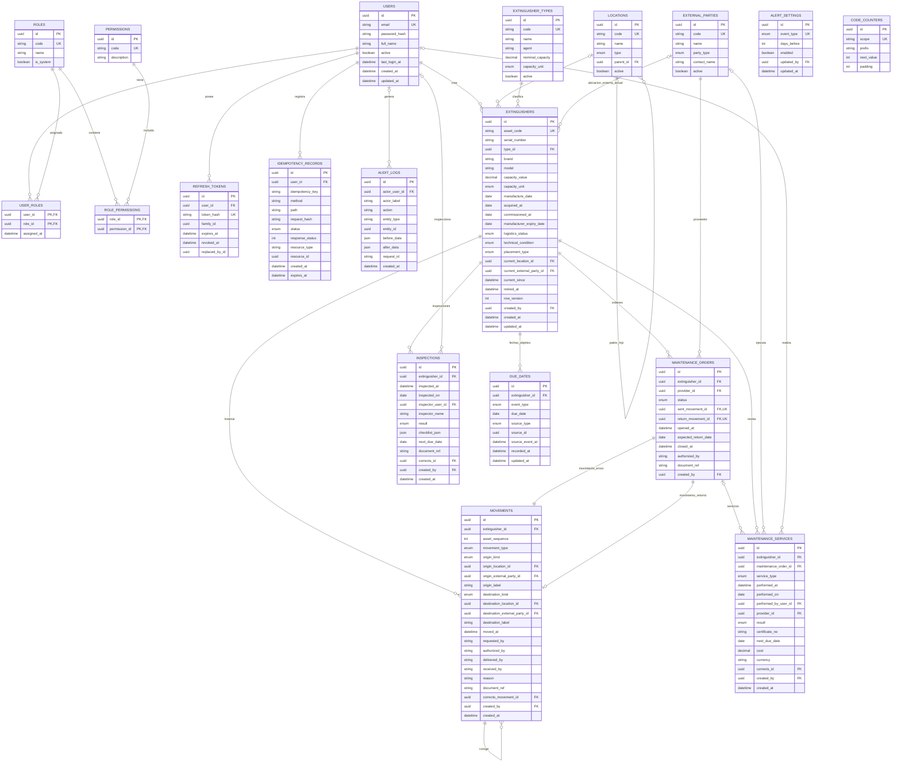

# Modelo entidad-relación — SITE

> **Estado:** propuesta para revisión. Refina `docs/03-modelo-de-datos.md`; no lo reemplaza. La migración definitiva se genera solo después de aprobar las decisiones bloqueantes.
>
> **Motor:** MySQL 8 / InnoDB. **ORM:** Prisma. **Zona horaria:** eventos en UTC; fechas calendario sin hora.

---

## 1. Convenciones de modelado

| Convención | Decisión |
|---|---|
| Identificadores | `CHAR(36)` con UUID v4; legibles en API y logs. |
| Nombres | Tablas y columnas en `snake_case`; modelos Prisma en `PascalCase` con `@@map`/`@map`. |
| Fechas de evento | `DATETIME(3)` en UTC. |
| Fechas calendario | `DATE` (fabricación, vencimiento documentado, próxima fecha). |
| Dinero | `DECIMAL(12,2)` + moneda `CHAR(3)`; opcional en MVP. |
| Booleanos | `TINYINT(1)`. |
| Catálogos | Se desactivan (`active = 0`), no se borran si están referenciados. |
| Historial | Sin `UPDATE`/`DELETE` en movimientos, inspecciones, servicios y auditoría. |
| Borrado | `ON DELETE RESTRICT` en relaciones históricas; sin borrado físico de activos. |
| Proyección | `extinguishers` guarda la colocación/estado actual; solo la actualiza el servicio de movimientos. |
| Fechas objetivo | Tabla `due_dates`, una fila por activo y categoría; se recalcula desde eventos documentados. |

---

## 2. Diagrama entidad-relación

> `DUE_DATES.source_id` es una referencia polimórfica (`EXTINGUISHER`, `INSPECTION` o `MAINTENANCE_SERVICE`); no puede tener una FK única. La integridad se valida en el servicio y se prueba con integración.

---

## 3. Enumeraciones

| Enum | Valores | Nota |
|---|---|---|
| `LocationType` | `SEDE`, `ALMACEN`, `AREA`, `TALLER` | D-02 aprobada: `SEDE` es la raíz; `ALMACEN`, `TALLER` y `AREA` son hijos de una sede. Sin edificios, pisos ni puntos en el MVP. Solo `ALMACEN` produce `EN_ALMACEN`; `TALLER` aloja equipos en mantenimiento interno. |
| `LogisticsStatus` | `EN_ALMACEN`, `ASIGNADO`, `EN_MANTENIMIENTO`, `DADO_DE_BAJA` | `EN_TRANSITO` reservado, no se usa en MVP. |
| `TechnicalCondition` | `OPERATIVO`, `OBSERVADO`, `NO_OPERATIVO`, `PENDIENTE_INSPECCION` | Catálogo administrable en fase 2. |
| `PlacementType` | `INTERNAL`, `EXTERNAL`, `NONE` | Mutuamente excluyente con las FKs. |
| `MovementType` | `INGRESO`, `SALIDA`, `TRASLADO`, `RETORNO_ALMACEN`, `ENVIO_MANTENIMIENTO`, `RETORNO_MANTENIMIENTO`, `BAJA`, `AJUSTE` | `INGRESO` solo en alta. |
| `EntrySource` | `COMPRA_CENTRAL`, `COMPRA_LOCAL`, `CARGA_INICIAL`, `RETORNO_MANTENIMIENTO`, `TRASLADO` | Obligatorio solo en `INGRESO` (D-03). |
| `MovementEndpointKind` | `LOCATION`, `EXTERNAL_PARTY`, `NONE` | Origen/destino. |
| `MaintenanceOrderStatus` | `ABIERTA`, `EN_PROVEEDOR`, `CERRADA`, `CANCELADA` | Solo una activa por activo. |
| `ServiceType` | `MANTENIMIENTO`, `RECARGA`, `REPARACION`, `PRUEBA_HIDROSTATICA` | Cada uno actualiza su propia fecha objetivo. |
| `ServiceResult` | `APROBADO`, `APROBADO_CON_OBSERVACIONES`, `RECHAZADO` | Sin mapeo automático; el resultado es evidencia y el cambio de condición es una acción explícita (D-10 aprobada). |
| `InspectionResult` | `APROBADO`, `APROBADO_CON_OBSERVACIONES`, `RECHAZADO` | No cambia condición automáticamente. |
| `DueDateEventType` | `EQUIPO`, `INSPECCION`, `MANTENIMIENTO`, `RECARGA`, `PRUEBA_HIDROSTATICA` | Categorías independientes. |
| `DueDateSourceType` | `EXTINGUISHER`, `INSPECTION`, `MAINTENANCE_SERVICE` | Fuente documental. |
| `ExternalPartyType` | `PROVEEDOR_MANTENIMIENTO`, `TALLER`, `PROVEEDOR`, `OTRO` | Catálogo. |

---

## 4. Diccionario de tablas principales

### 4.1 `users`

| Columna | Tipo | Nulo | Restricción / nota |
|---|---|---:|---|
| `id` | `CHAR(36)` | No | PK. |
| `email` | `VARCHAR(255)` | No | Único; normalizado a minúsculas en servicio. |
| `password_hash` | `VARCHAR(255)` | No | Argon2id o bcrypt costo ≥12; nunca texto plano. |
| `full_name` | `VARCHAR(150)` | No | |
| `active` | `TINYINT(1)` | No | Default 1; desactivación lógica. |
| `must_change_password` | `TINYINT(1)` | No | Default 1 para usuarios creados por admin. |
| `last_login_at` | `DATETIME(3)` | Sí | UTC. |
| `failed_login_attempts` | `INT UNSIGNED` | No | Default 0. |
| `locked_until` | `DATETIME(3)` | Sí | Bloqueo temporal opcional. |
| `created_by` | `CHAR(36)` | Sí | FK `users.id`. |
| `created_at` | `DATETIME(3)` | No | UTC. |
| `updated_at` | `DATETIME(3)` | No | UTC. |
| `deactivated_at` | `DATETIME(3)` | Sí | |

Índices: `UNIQUE(email)`, `INDEX(active)`, `INDEX(deactivated_at)`.

### 4.2 `roles`, `permissions`, `user_roles`, `role_permissions`

| Tabla | Columnas clave | Restricciones |
|---|---|---|
| `roles` | `id`, `code` UK, `name`, `description`, `is_system` | Códigos estables: `ADMIN`, `ALMACEN`, `SEGURIDAD`, `CONSULTA`. |
| `permissions` | `id`, `code` UK, `description` | Códigos como `extinguishers.read`, `movements.create`. |
| `user_roles` | `user_id`, `role_id`, `assigned_at`, `assigned_by` | PK compuesta; FK `RESTRICT`/`CASCADE` solo si se borrara un usuario (no permitido). |
| `role_permissions` | `role_id`, `permission_id` | PK compuesta. |

### 4.3 `refresh_tokens`

| Columna | Tipo | Nulo | Nota |
|---|---|---:|---|
| `id` | `CHAR(36)` | No | PK. |
| `user_id` | `CHAR(36)` | No | FK `users.id`. |
| `token_hash` | `CHAR(64)` | No | SHA-256 del refresh token; único. |
| `family_id` | `CHAR(36)` | No | Agrupa la cadena de rotaciones para revocar la familia ante reutilización. |
| `expires_at` | `DATETIME(3)` | No | UTC. |
| `revoked_at` | `DATETIME(3)` | Sí | |
| `replaced_by_id` | `CHAR(36)` | Sí | Rotación. |
| `user_agent` | `VARCHAR(255)` | Sí | |
| `ip` | `VARCHAR(45)` | Sí | IPv4/IPv6. |
| `created_at` | `DATETIME(3)` | No | |

Índices: `UNIQUE(token_hash)`, `INDEX(user_id, expires_at)`, `INDEX(family_id)`, `INDEX(revoked_at)`.

### 4.4 `locations`

| Columna | Tipo | Nulo | Nota |
|---|---|---:|---|
| `id` | `CHAR(36)` | No | PK. |
| `code` | `VARCHAR(30)` | No | Único; generado por el servidor (`UBI-000001`), inmutable y no aceptado del cliente (D-02). |
| `name` | `VARCHAR(150)` | No | Único dentro de la sede, sin distinguir mayúsculas; puede repetirse entre sedes. |
| `type` | `ENUM(LocationType)` | No | `SEDE`, `ALMACEN`, `AREA` o `TALLER`. |
| `parent_id` | `CHAR(36)` | Sí | FK `locations.id`. Nulo solo para `SEDE`; en los demás tipos debe apuntar a una `SEDE` activa. Sin ciclos y sin anidar áreas. |
| `address` | `VARCHAR(255)` | Sí | |
| `active` | `TINYINT(1)` | No | Default 1. Baja lógica; nunca se borra una ubicación con historial. |
| `created_by` | `CHAR(36)` | Sí | FK `users.id`. |
| `created_at` | `DATETIME(3)` | No | |
| `updated_at` | `DATETIME(3)` | No | |

Índices: `UNIQUE(code)`, `UNIQUE(parent_id, name)` para las ubicaciones hijas, `INDEX(parent_id)`, `INDEX(type)`, `INDEX(active)`. La unicidad de nombre de las sedes se valida en servicio porque MySQL permite varios `NULL` en un índice único. Las sedes no alojan activos directamente.

### 4.5 `extinguisher_types` y `external_parties`

| Tabla | Columnas | Restricciones |
|---|---|---|
| `extinguisher_types` | `id`, `code` UK, `name`, `agent`, `nominal_capacity`, `capacity_unit`, `description`, `active`, timestamps | `agent` texto configurable (PQS, CO2, agua, espuma, etc.); no contiene periodos. |
| `external_parties` | `id`, `code` UK, `name`, `party_type`, `tax_id`, `contact_name`, `phone`, `email`, `address`, `active`, `notes`, timestamps | Proveedor/taller; desactivación lógica. |

Índices: `UNIQUE(code)`, `INDEX(active)`, `INDEX(party_type)`, `INDEX(name)`.

### 4.6 `extinguishers`

| Columna | Tipo | Nulo | Restricción / nota |
|---|---|---:|---|
| `id` | `CHAR(36)` | No | PK. |
| `asset_code` | `VARCHAR(20)` | No | Único, inmutable, patrón `^[A-Z0-9][A-Z0-9_-]{2,19}$`; generado como `EXT-000001`; no se reutiliza. |
| `serial_number` | `VARCHAR(100)` | Sí | No único por defecto (D-16); índice para búsqueda. |
| `type_id` | `CHAR(36)` | No | FK `extinguisher_types.id`. |
| `brand` | `VARCHAR(100)` | Sí | |
| `model` | `VARCHAR(100)` | Sí | |
| `capacity_value` | `DECIMAL(10,2)` | No | Capacidad real del activo. |
| `capacity_unit` | `ENUM('KG','L','LB')` | No | |
| `manufacture_date` | `DATE` | Sí | No futura. |
| `acquired_at` | `DATE` | Sí | No anterior a fabricación. |
| `commissioned_at` | `DATE` | Sí | No anterior a adquisición. |
| `manufacturer_expiry_date` | `DATE` | Sí | Solo documentada; no calculada. |
| `logistics_status` | `ENUM(LogisticsStatus)` | No | |
| `technical_condition` | `ENUM(TechnicalCondition)` | No | |
| `placement_type` | `ENUM(PlacementType)` | No | |
| `current_location_id` | `CHAR(36)` | Sí | FK `locations.id`. |
| `current_external_party_id` | `CHAR(36)` | Sí | FK `external_parties.id`. |
| `current_since` | `DATETIME(3)` | Sí | Último movimiento confirmado; UTC. |
| `retired_at` | `DATETIME(3)` | Sí | Obligatorio si `DADO_DE_BAJA`. |
| `retirement_reason` | `VARCHAR(500)` | Sí | |
| `notes` | `TEXT` | Sí | Sin datos sensibles innecesarios. |
| `row_version` | `INT UNSIGNED` | No | Default 1; control optimista. |
| `created_by` | `CHAR(36)` | No | FK `users.id`. |
| `created_at` | `DATETIME(3)` | No | |
| `updated_at` | `DATETIME(3)` | No | |

Índices:

- `UNIQUE(asset_code)`
- `INDEX(serial_number)`
- `INDEX(current_location_id, logistics_status)`
- `INDEX(current_external_party_id)`
- `INDEX(logistics_status)`
- `INDEX(technical_condition)`
- `INDEX(type_id)`
- `INDEX(manufacturer_expiry_date)`
- `INDEX(created_at)`

### 4.7 `movements`

| Columna | Tipo | Nulo | Restricción / nota |
|---|---|---:|---|
| `id` | `CHAR(36)` | No | PK. |
| `extinguisher_id` | `CHAR(36)` | No | FK `extinguishers.id`. |
| `asset_sequence` | `INT UNSIGNED` | No | Único por activo; empieza en 1. |
| `movement_type` | `ENUM(MovementType)` | No | |
| `entry_source` | `ENUM(EntrySource)` | Sí | Obligatorio si `movement_type = 'INGRESO'`; nulo en los demás. |
| `origin_kind` | `ENUM(MovementEndpointKind)` | No | |
| `origin_location_id` | `CHAR(36)` | Sí | FK `locations.id`. |
| `origin_external_party_id` | `CHAR(36)` | Sí | FK `external_parties.id`. |
| `origin_label` | `VARCHAR(255)` | No | Snapshot del nombre al momento. |
| `destination_kind` | `ENUM(MovementEndpointKind)` | No | |
| `destination_location_id` | `CHAR(36)` | Sí | FK `locations.id`. |
| `destination_external_party_id` | `CHAR(36)` | Sí | FK `external_parties.id`. |
| `destination_label` | `VARCHAR(255)` | No | Snapshot. |
| `moved_at` | `DATETIME(3)` | No | Fecha del hecho; UTC. |
| `requested_by` | `VARCHAR(150)` | Sí | |
| `authorized_by` | `VARCHAR(150)` | Sí | |
| `delivered_by` | `VARCHAR(150)` | Sí | |
| `received_by` | `VARCHAR(150)` | Sí | |
| `reason` | `VARCHAR(500)` | No | Longitud mínima 5. |
| `document_ref` | `VARCHAR(100)` | Sí | Obligatorio por tipo. |
| `notes` | `TEXT` | Sí | |
| `corrects_movement_id` | `CHAR(36)` | Sí | FK `movements.id`; solo `AJUSTE`. |
| `created_by` | `CHAR(36)` | No | FK `users.id`; tomado de la sesión. |
| `created_at` | `DATETIME(3)` | No | Sello del servidor. |

Índices:

- `UNIQUE(extinguisher_id, asset_sequence)`
- `INDEX(extinguisher_id, moved_at)`
- `INDEX(movement_type, moved_at)`
- `INDEX(origin_location_id)`
- `INDEX(destination_location_id)`
- `INDEX(origin_external_party_id)`
- `INDEX(destination_external_party_id)`
- `INDEX(created_by, created_at)`
- `INDEX(created_at)`

Sin `updated_at`: es inmutable. `asset_sequence` refleja el orden de inserción; la línea de tiempo para el usuario se ordena por `moved_at` y, en empate, por `asset_sequence`. Un `AJUSTE` retroactivo puede tener una secuencia mayor pero una fecha menor; se muestra con su justificación.

### 4.8 `maintenance_orders`

| Columna | Tipo | Nulo | Restricción / nota |
|---|---|---:|---|
| `id` | `CHAR(36)` | No | PK. |
| `extinguisher_id` | `CHAR(36)` | No | FK `extinguishers.id`. |
| `provider_id` | `CHAR(36)` | Sí | FK `external_parties.id`; obligatorio si la orden es externa. |
| `workshop_location_id` | `CHAR(36)` | Sí | FK `locations.id` de tipo `TALLER`; obligatorio si la orden es interna. |
| `status` | `ENUM(MaintenanceOrderStatus)` | No | |
| `sent_movement_id` | `CHAR(36)` | No | FK `movements.id`; único. |
| `return_movement_id` | `CHAR(36)` | Sí | FK `movements.id`; único. |
| `opened_at` | `DATETIME(3)` | No | |
| `expected_return_date` | `DATE` | Sí | No anterior al envío. |
| `closed_at` | `DATETIME(3)` | Sí | |
| `reason` | `VARCHAR(500)` | No | |
| `authorized_by` | `VARCHAR(150)` | Sí | |
| `document_ref` | `VARCHAR(100)` | Sí | |
| `notes` | `TEXT` | Sí | |
| `created_by` | `CHAR(36)` | No | FK `users.id`. |
| `created_at` | `DATETIME(3)` | No | |
| `updated_at` | `DATETIME(3)` | No | |
| `active_key` | `CHAR(36)` generado | Sí | `CASE WHEN status IN ('ABIERTA','EN_PROVEEDOR') THEN extinguisher_id ELSE NULL END`; único. |

Índices: `INDEX(extinguisher_id, status)`, `INDEX(provider_id)`, `INDEX(workshop_location_id)`, `INDEX(expected_return_date)`, `UNIQUE(sent_movement_id)`, `UNIQUE(return_movement_id)`, `UNIQUE(active_key)`.

### 4.9 `maintenance_services`

| Columna | Tipo | Nulo | Restricción / nota |
|---|---|---:|---|
| `id` | `CHAR(36)` | No | PK. |
| `extinguisher_id` | `CHAR(36)` | No | FK `extinguishers.id`. |
| `maintenance_order_id` | `CHAR(36)` | Sí | FK `maintenance_orders.id`; nulo para servicio interno. |
| `service_type` | `ENUM(ServiceType)` | No | |
| `performed_at` | `DATETIME(3)` | No | UTC; no futuro. |
| `performed_on` | `DATE` | No | Fecha calendario en la zona de la organización, derivada de `performed_at`. |
| `performed_by_user_id` | `CHAR(36)` | Sí | FK `users.id` para servicio interno. |
| `provider_id` | `CHAR(36)` | Sí | FK `external_parties.id` para servicio externo. |
| `result` | `ENUM(ServiceResult)` | No | |
| `certificate_no` | `VARCHAR(100)` | Sí | Documento/certificado. |
| `certificate_date` | `DATE` | Sí | |
| `next_due_date` | `DATE` | Sí | Indicada, no calculada; debe ser posterior a `performed_at`. |
| `cost` | `DECIMAL(12,2)` | Sí | Opcional. |
| `currency` | `CHAR(3)` | Sí | Default `PEN` si hay costo. |
| `notes` | `TEXT` | Sí | |
| `document_ref` | `VARCHAR(100)` | Sí | |
| `corrects_id` | `CHAR(36)` | Sí | FK `maintenance_services.id`. |
| `created_by` | `CHAR(36)` | No | FK `users.id`. |
| `created_at` | `DATETIME(3)` | No | |

Índices: `INDEX(extinguisher_id, performed_at)`, `INDEX(service_type, next_due_date)`, `INDEX(maintenance_order_id)`, `INDEX(provider_id)`, `INDEX(next_due_date)`.

Sin `updated_at`: inmutable; corrección = nueva fila.

### 4.10 `inspections`

| Columna | Tipo | Nulo | Restricción / nota |
|---|---|---:|---|
| `id` | `CHAR(36)` | No | PK. |
| `extinguisher_id` | `CHAR(36)` | No | FK `extinguishers.id`. |
| `inspected_at` | `DATETIME(3)` | No | UTC; no futuro. |
| `inspected_on` | `DATE` | No | Fecha calendario en la zona de la organización, derivada de `inspected_at`. |
| `inspector_user_id` | `CHAR(36)` | Sí | FK `users.id` si es usuario interno. |
| `inspector_name` | `VARCHAR(150)` | No | Snapshot del nombre. |
| `result` | `ENUM(InspectionResult)` | No | |
| `checklist_json` | `JSON` | Sí | Estructura versionada; validar tamaño. |
| `next_due_date` | `DATE` | Sí | Posterior a `inspected_at`. |
| `notes` | `TEXT` | Sí | |
| `document_ref` | `VARCHAR(100)` | Sí | |
| `corrects_id` | `CHAR(36)` | Sí | FK `inspections.id`. |
| `created_by` | `CHAR(36)` | No | FK `users.id`. |
| `created_at` | `DATETIME(3)` | No | |

Índices: `INDEX(extinguisher_id, inspected_at)`, `INDEX(next_due_date)`, `INDEX(inspector_user_id)`, `INDEX(result)`.

### 4.11 `due_dates`

| Columna | Tipo | Nulo | Restricción / nota |
|---|---|---:|---|
| `id` | `CHAR(36)` | No | PK. |
| `extinguisher_id` | `CHAR(36)` | No | FK `extinguishers.id`. |
| `event_type` | `ENUM(DueDateEventType)` | No | |
| `due_date` | `DATE` | No | Fecha documentada. |
| `source_type` | `ENUM(DueDateSourceType)` | No | |
| `source_id` | `CHAR(36)` | No | Referencia polimórfica. |
| `source_event_at` | `DATETIME(3)` | Sí | Fecha del evento fuente para comparar. |
| `recorded_at` | `DATETIME(3)` | No | |
| `updated_at` | `DATETIME(3)` | No | |

Índices: `UNIQUE(extinguisher_id, event_type)`, `INDEX(event_type, due_date)`, `INDEX(due_date)`, `INDEX(source_type, source_id)`.

**Regla de proyección:** una fila por activo/categoría. Si no hay fecha documentada, no hay fila. Si un evento nuevo tiene fecha posterior al actual, reemplaza; si es anterior, no reemplaza. Si el evento nuevo no trae `next_due_date`, se elimina la fila de esa categoría.

### 4.12 `alert_settings`

| Columna | Tipo | Nulo | Nota |
|---|---|---:|---|
| `id` | `CHAR(36)` | No | PK. |
| `event_type` | `ENUM(DueDateEventType)` | No | Único. |
| `days_before` | `INT` | Sí | ≥ 0; nulo = sin umbral configurado. |
| `enabled` | `TINYINT(1)` | No | Default 1. |
| `updated_by` | `CHAR(36)` | No | FK `users.id`. |
| `updated_at` | `DATETIME(3)` | No | |

No se siembran valores de días por defecto. La instalación crea las filas con `days_before = NULL`; el administrador las configura con la política aprobada.

### 4.13 `audit_logs`

| Columna | Tipo | Nulo | Nota |
|---|---|---:|---|
| `id` | `CHAR(36)` | No | PK. |
| `actor_user_id` | `CHAR(36)` | Sí | FK `users.id`; nulo para acciones de sistema. |
| `actor_label` | `VARCHAR(255)` | No | Snapshot de identidad para conservar trazabilidad. |
| `action` | `VARCHAR(80)` | No | Ej. `EXTINGUISHER_CREATED`, `MOVEMENT_CREATED`. |
| `entity_type` | `VARCHAR(50)` | No | |
| `entity_id` | `CHAR(36)` | Sí | |
| `before_data` | `JSON` | Sí | Redactado. |
| `after_data` | `JSON` | Sí | Redactado. |
| `ip` | `VARCHAR(45)` | Sí | |
| `user_agent` | `VARCHAR(255)` | Sí | |
| `request_id` | `CHAR(36)` | Sí | Correlación. |
| `created_at` | `DATETIME(3)` | No | |

Índices: `INDEX(entity_type, entity_id, created_at)`, `INDEX(actor_user_id, created_at)`, `INDEX(created_at)`, `INDEX(action)`.

### 4.14 `idempotency_records`

| Columna | Tipo | Nulo | Nota |
|---|---|---:|---|
| `id` | `CHAR(36)` | No | PK. |
| `user_id` | `CHAR(36)` | No | FK `users.id`. |
| `idempotency_key` | `VARCHAR(64)` | No | Valor del header `Idempotency-Key`. |
| `method` | `VARCHAR(10)` | No | `POST`. |
| `path` | `VARCHAR(255)` | No | Ruta normalizada. |
| `request_hash` | `CHAR(64)` | No | SHA-256 del payload canónico; detecta misma clave con payload distinto. |
| `status` | `ENUM('PROCESSING','COMPLETED')` | No | No se persiste `FAILED`: si la transacción falla, se revierte. |
| `response_status` | `SMALLINT` | Sí | Código HTTP de la respuesta original. |
| `resource_type` | `VARCHAR(50)` | Sí | Ej. `EXTINGUISHER`, `MOVEMENT`, `MAINTENANCE_ORDER`. |
| `resource_id` | `CHAR(36)` | Sí | Para reconstruir/consultar la respuesta. |
| `created_at` | `DATETIME(3)` | No | |
| `expires_at` | `DATETIME(3)` | No | Limpieza después de 24 h por defecto. |

Índices: `UNIQUE(user_id, idempotency_key)`, `INDEX(expires_at)`, `INDEX(resource_type, resource_id)`.

**Flujo:** dentro de la misma transacción de la operación, insertar `PROCESSING`; si la clave ya existe, comparar `request_hash` y devolver el recurso existente o 409. Al confirmar, actualizar a `COMPLETED` con `response_status` y `resource_id`. Si la operación falla, la transacción revierte el registro y la clave puede reutilizarse. Un registro `PROCESSING` bloqueado por otra transacción se resuelve por el bloqueo de la unique key.

### 4.15 `code_counters`

| Columna | Tipo | Nulo | Nota |
|---|---|---:|---|
| `id` | `CHAR(36)` | No | PK. |
| `scope` | `VARCHAR(30)` | No | Único; ej. `EXTINGUISHER`. |
| `prefix` | `VARCHAR(10)` | No | Ej. `EXT-`. |
| `next_value` | `INT UNSIGNED` | No | Se incrementa bajo bloqueo. |
| `padding` | `TINYINT UNSIGNED` | No | Ej. 6. |
| `updated_at` | `DATETIME(3)` | No | |

---

## 5. Restricciones de integridad

### 5.1 Restricciones declarativas

| ID | Restricción | Implementación |
|---|---|---|
| C-01 | `asset_code` único | `UNIQUE` |
| C-02 | `asset_code` con patrón estable | `CHECK (asset_code REGEXP '^[A-Z0-9][A-Z0-9_-]{2,19}$')`; el generador usa `EXT-` + 6 dígitos |
| C-03 | Una colocación interna o externa, no ambas | `CHECK` sobre `placement_type` y FKs |
| C-04 | `DADO_DE_BAJA` implica `placement_type='NONE'` y `retired_at` no nulo | `CHECK` |
| C-05 | `retired_at` nulo si no está dado de baja | `CHECK` |
| C-06 | `row_version` ≥ 1 | `CHECK` |
| C-07 | Movimiento con origen/destino coherente con su `kind` | `CHECK` |
| C-08 | Secuencia única por activo | `UNIQUE(extinguisher_id, asset_sequence)` |
| C-09 | Idempotencia por usuario | `UNIQUE(user_id, idempotency_key)` en `idempotency_records` |
| C-10 | Una orden activa por activo | Columna generada `active_key` + `UNIQUE` |
| C-11 | `next_due_date` posterior al evento | `CHECK (next_due_date IS NULL OR next_due_date > performed_on)` en servicios e inspecciones; `performed_on`/`inspected_on` es la fecha local del evento. |
| C-12 | `days_before` ≥ 0 | `CHECK` |
| C-13 | Una fecha objetivo por activo/categoría | `UNIQUE(extinguisher_id, event_type)` |
| C-14 | No hay dos órdenes con el mismo movimiento de envío/retorno | `UNIQUE(sent_movement_id)`, `UNIQUE(return_movement_id)` |
| C-15 | Una orden de mantenimiento es interna o externa, no ambas | `CHECK ((provider_id IS NULL) <> (workshop_location_id IS NULL))` |
| C-16 | Jerarquía de ubicaciones de máximo dos niveles | Validación de servicio: `SEDE` con `parent_id` nulo; `ALMACEN`, `TALLER` y `AREA` con padre de tipo `SEDE`; prohibido anidar hijos. |
| C-17 | Nombre de ubicación único dentro de su sede | `UNIQUE(parent_id, name)` para hijas; validación de servicio para sedes (varios `NULL` no se comparan en MySQL). Sin distinguir mayúsculas por la colación. |

> MySQL no permite `CHECK` con subconsultas (por ejemplo, validar que la ubicación sea de tipo `ALMACEN`). Esa coherencia se valida en el servicio y se cubre con pruebas de integración; opcionalmente se puede añadir un trigger, que debe documentarse y probarse.

### 5.2 Invariantes de servicio

| ID | Invariante |
|---|---|
| I-01 | `EN_ALMACEN` ⇒ colocación interna en ubicación activa de tipo `ALMACEN`. |
| I-02 | `ASIGNADO` ⇒ colocación interna en ubicación activa de tipo `AREA`. |
| I-03 | `EN_MANTENIMIENTO` ⇒ orden activa y, o bien colocación interna en ubicación activa de tipo `TALLER`, o bien colocación externa en proveedor activo. |
| I-04 | `DADO_DE_BAJA` ⇒ colocación `NONE`, sin FKs actuales y `retired_at` no nulo. |
| I-05 | Todo activo existente tiene al menos un movimiento (`INGRESO` inicial). |
| I-06 | La secuencia de movimientos empieza en 1 y no tiene huecos por activo. |
| I-07 | La ubicación/estado actual coincide con el último movimiento confirmado. |
| I-08 | Una orden activa tiene exactamente un movimiento de envío y ningún retorno. |
| I-09 | Una orden cerrada tiene movimiento de retorno y al menos un servicio. |
| I-10 | Una fecha objetivo apunta a una fuente existente y coherente con su categoría. |

---

## 6. Índices y rendimiento

| Consulta típica | Índice |
|---|---|
| Buscar activo por código/QR | `UNIQUE(extinguishers.asset_code)` |
| Buscar por serie | `INDEX(extinguishers.serial_number)` |
| Inventario por ubicación/estado | `INDEX(current_location_id, logistics_status)` |
| Inventario por condición/tipo | `INDEX(technical_condition)`, `INDEX(type_id)` |
| Historial por activo | `INDEX(movements.extinguisher_id, moved_at)` |
| Movimientos por tipo/periodo | `INDEX(movement_type, moved_at)`, `INDEX(created_at)` |
| Órdenes abiertas | `INDEX(extinguisher_id, status)`, `INDEX(expected_return_date)` |
| Servicios por activo/fecha | `INDEX(extinguisher_id, performed_at)` |
| Inspecciones próximas | `INDEX(inspections.next_due_date)` |
| Alertas por categoría/fecha | `INDEX(due_dates.event_type, due_date)` |
| Auditoría por entidad | `INDEX(entity_type, entity_id, created_at)` |
| Sesiones/refresh | `INDEX(refresh_tokens.user_id, expires_at)` |

Con 10 000 activos y 100 000 movimientos, los listados deben paginarse y filtrarse en servidor. No se permite cargar todo el inventario en el navegador para filtrar localmente.

---

## 7. Proyección de fechas objetivo

| Categoría | Fuente | Regla |
|---|---|---|
| `EQUIPO` | `extinguishers.manufacturer_expiry_date` | Se crea/actualiza/elimina al crear o editar la ficha; auditoría. |
| `INSPECCION` | Última `inspection` por `inspected_at` (desempate `created_at`) | `due_date = next_due_date`; si es nula, se elimina la fila. |
| `MANTENIMIENTO` | Último `maintenance_service` de tipo `MANTENIMIENTO` | Solo actualiza esa categoría. |
| `RECARGA` | Último `maintenance_service` de tipo `RECARGA` | Solo actualiza esa categoría. |
| `PRUEBA_HIDROSTATICA` | Último `maintenance_service` de tipo `PRUEBA_HIDROSTATICA` | Solo actualiza esa categoría. |

**Comparación:** se actualiza la proyección solo si el evento nuevo tiene `source_event_at` posterior, o igual con `created_at` posterior. Un evento retroactivo anterior no pisa la fecha vigente. Una corrección se registra como nuevo evento con `corrects_id` y fecha/creación posterior.

**Consecuencia:** si una inspección nueva no indica próxima fecha, la categoría queda `SIN_FECHA_CONFIGURADA`. No se conserva una fecha antigua como si siguiera vigente.

---

## 8. Cambios respecto de `docs/03-modelo-de-datos.md`

| Cambio | Motivo |
|---|---|
| Se separan `maintenance_orders` y `maintenance_services`. | El envío/retorno externo es un ciclo con orden, proveedor y retorno; los servicios son eventos técnicos inmutables. |
| Se agrega `due_dates` como proyección. | Evita mezclar fechas y permite alertas deterministas y consultas indexadas. |
| No se persiste `alerts` en el MVP. | Se calculan desde `due_dates` + `alert_settings`; no se duplican. Se reserva una tabla de notificaciones para fase 2. |
| Se agrega `code_counters`. | Generación segura y no reutilizable de `asset_code`. |
| Se agregan `permissions`, `role_permissions`, `refresh_tokens`. | RBAC granular y sesión con refresh rotativo. |
| `extinguishers.active` se reemplaza por estado logístico. | Evita duplicar “activo” con `DADO_DE_BAJA`. |
| Se agregan `placement_type` y `current_external_party_id`. | Permite representar mantenimiento externo sin almacenes ficticios. |
| Se agregan snapshots de origen/destino y `asset_sequence` en movimientos. | Trazabilidad y orden estable aunque se renombren ubicaciones. |
| Se agrega `idempotency_records` y `row_version`. | Protección contra doble envío, detección de payload distinto y concurrencia. |
| Se agrega `actor_label` en auditoría. | Conserva identidad aunque el usuario se desactive. |
| Se agrega `entry_source` a `movements`. | Explica por qué un equipo aparece en una ubicación sin pasar por almacén (D-03). |
| Se agrega `TALLER` a `LocationType` y `workshop_location_id` a `maintenance_orders`. | Permite mantenimiento en taller propio sin simular un proveedor externo (D-31). `provider_id` pasa a nullable con `CHECK` de exclusividad. |
| `movement_batches` no se incluye. | Un movimiento por activo en MVP; lotes en fase 2. |

---

## 9. Notas de migración Prisma

- Crear la migración inicial con Prisma Migrate y luego aplicar SQL manual para:
  - `CHECK` constraints.
  - Columna generada `maintenance_orders.active_key` y su índice único.
  - Índices que Prisma no exprese directamente.
- Verificar que `prisma migrate deploy` funcione desde una base vacía y desde la versión anterior.
- Usar `@db.Char(36)` para UUIDs, `@db.Date`, `@db.DateTime(3)`, `@db.Decimal(12,2)`.
- Definir `onDelete: Restrict` en relaciones históricas.
- No usar `onDelete: Cascade` en `movements`, `inspections`, `maintenance_services`, `maintenance_orders`, `due_dates` ni `audit_logs`.
- Los enums de MySQL requieren migración para agregar valores; documentar el procedimiento.
- Sembrar solo catálogos mínimos y datos ficticios de desarrollo; no sembrar umbrales ni fechas técnicas inventadas.

---

## 10. Retención y respaldo

- **Historial operativo:** se conserva indefinidamente por defecto; la política de archivo se define con el propietario (D-21).
- **Auditoría:** append-only; no se elimina desde la aplicación.
- **Usuarios:** se desactivan, no se borran.
- **Ubicaciones/catálogos:** se desactivan si están referenciados.
- **Respaldos:** copia diaria cifrada de MySQL; prueba de restauración al menos trimestral o antes de cada despliegue mayor. RPO/RTO a confirmar (D-23).
- **Datos de desarrollo:** seed separado, identificado, nunca restaurado sobre producción.
