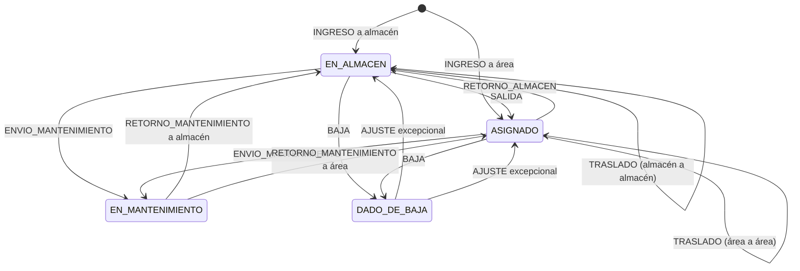

# Reglas de negocio — SITE

> **Estado:** propuesta para revisión. Las reglas marcadas con `[D-xx]` dependen de una decisión pendiente documentada en `docs/decisiones-pendientes.md`.
>
> **Principio:** una regla no está implementada por estar escrita en la interfaz. Debe aplicarse en el backend y, cuando sea posible, reforzarse en la base de datos. La interfaz puede ocultar acciones, pero nunca es la última barrera.

---

## 1. Convenciones

- **Debe:** obligatorio en el MVP.
- **No debe:** prohibido; el backend rechaza la operación.
- **Puede:** permitido con validaciones.
- **Fuente de verdad:** movimientos confirmados para ubicación/estado; registros técnicos para fechas; configuración aprobada para umbrales.
- **Inmutabilidad:** un registro confirmado no se actualiza ni se borra; se corrige con otro registro auditado.
- **Transacción:** operación atómica en MySQL/InnoDB. Si falla un paso crítico, se revierte todo.

---

## 2. Identidad del activo

| ID | Regla | Cumplimiento |
|---|---|---|
| BR-001 | Cada extintor es un activo individual con ficha propia. | Modelo `extinguishers`; no se aceptan cantidades agregadas como sustituto de unidades. |
| BR-002 | `asset_code` es único, obligatorio e inmutable. | `UNIQUE(asset_code)`; sin endpoint de cambio; validación en servicio. |
| BR-003 | `asset_code` no se reutiliza, ni siquiera después de una baja. | Contador que solo incrementa; no hay borrado físico; el código no se acepta como entrada del cliente (D-04 aprobada). |
| BR-004 | El código interno es independiente del número de serie del fabricante. | Campos separados; el QR usa `asset_code`. |
| BR-005 | El número de serie es opcional. | `serial_number NULL`; no se inventa. |
| BR-006 | El número de serie es opcional y **no único** (D-16 aprobada). Se advierte y reporta duplicados. | `INDEX(serial_number)`; validación de duplicados en alta e importación. |
| BR-007 | El código no puede contener datos personales, ubicación ni fechas. | Generado como `EXT-000000`; **sin importación de códigos en el MVP** (D-04 aprobada). |
| BR-008 | El alta crea ficha y movimiento inicial en la misma transacción. | Servicio de alta; prueba de rollback. |
| BR-009 | Un activo dado de baja conserva ficha e historial. | `DADO_DE_BAJA`; sin borrado; listados operativos lo excluyen. |
| BR-010 | No se permite eliminar físicamente un extintor. | Sin endpoint `DELETE`; FK `RESTRICT`. |
| BR-011 | Los campos descriptivos/técnicos pueden editarse con auditoría; la ubicación/estado no. | DTO de edición separado; rechazo de campos de proyección. |
| BR-012 | La condición técnica siempre tiene un valor explícito. | `NOT NULL`; se elige al alta y se cambia con acción auditada. |
| BR-012A | El conjunto de condiciones técnicas es fijo: `OPERATIVO`, `OBSERVADO`, `NO_OPERATIVO` y `PENDIENTE_INSPECCION` (D-26 aprobada). No es un catálogo administrable en el MVP. | `ENUM`; agregar o quitar valores exige migración y análisis de impacto. |
| BR-012B | El alta exige una condición inicial elegida por el usuario; no se asigna un valor por defecto silencioso. | DTO obligatorio; prueba de rechazo si falta. |
| BR-013 | La condición técnica no se deduce automáticamente de la ubicación. | Campos separados; validaciones independientes. |
| BR-014 | El estado logístico no se deduce automáticamente de la condición técnica. | Campos separados. |
| BR-014A | Un extintor `NO_OPERATIVO` no puede asignarse a un `AREA` ni darse de alta directamente en un área (D-26b aprobada). | Validación de destino y de alta; 422 `CONDITION_NOT_ASSIGNABLE`. |
| BR-014B | Un extintor `NO_OPERATIVO` sí puede ubicarse en `ALMACEN`, `TALLER` o proveedor externo, y puede enviarse a mantenimiento. | Validación de destino. |
| BR-014C | `OBSERVADO` y `PENDIENTE_INSPECCION` permiten cualquier ubicación, con advertencia visible. La condición no genera alertas por sí misma. | Aviso en UI; alertas solo por fechas. |
| BR-014D | Si el equipo está `ASIGNADO` en un área, no puede pasar a `NO_OPERATIVO`; primero se retira a almacén o taller. | Validación en el cambio de condición; mensaje que indique el movimiento requerido. |
| BR-015 | Un activo no puede estar simultáneamente en dos ubicaciones/contrapartes. | Una sola colocación actual; `placement_type` + FKs mutuamente excluyentes. |

---

## 3. Ubicaciones, colocación y estado

### 3.1 Invariantes de la proyección actual

| Estado logístico | Colocación | Condición adicional |
|---|---|---|
| `EN_ALMACEN` | `INTERNAL` | `current_location_id` apunta a una ubicación activa de tipo `ALMACEN`. |
| `ASIGNADO` | `INTERNAL` | `current_location_id` apunta a una ubicación activa de tipo `AREA`. |
| `EN_MANTENIMIENTO` | `INTERNAL` o `EXTERNAL` | Si es `INTERNAL`, `current_location_id` apunta a una ubicación activa de tipo `TALLER`; si es `EXTERNAL`, `current_external_party_id` apunta a una contraparte activa. En ambos casos existe una orden de mantenimiento activa. |
| `DADO_DE_BAJA` | `NONE` | `current_location_id` y `current_external_party_id` son nulos; `retired_at` no es nulo. |

| ID | Regla | Cumplimiento |
|---|---|---|
| BR-020 | `placement_type` solo puede ser `INTERNAL`, `EXTERNAL` o `NONE`. | Enum + `CHECK` en migración. |
| BR-021 | `INTERNAL` exige exactamente una ubicación interna y ninguna contraparte externa. | `CHECK` + validación de servicio. |
| BR-022 | `EXTERNAL` exige exactamente una contraparte externa y ninguna ubicación interna. | `CHECK` + validación. |
| BR-022A | `EN_MANTENIMIENTO` con colocación `INTERNAL` exige una ubicación activa de tipo `TALLER` y ninguna contraparte externa. (D-31 aprobada) | `CHECK` + validación de tipo. |
| BR-023 | `NONE` exige ambas referencias nulas y solo es válido para `DADO_DE_BAJA`. | `CHECK` + validación. |
| BR-024 | Solo una ubicación de tipo `ALMACEN` produce `EN_ALMACEN`. | Validación de destino; no se infiere por el nombre. |
| BR-024A | `ASIGNADO` exige una ubicación activa de tipo `AREA`; una `SEDE` nunca aloja un extintor. (D-02 aprobada) | Validación de destino; prueba de integración. |
| BR-025 | Una ubicación inactiva no puede ser destino de un movimiento nuevo. | Validación + estado `active`. |
| BR-026 | Una contraparte inactiva no puede recibir un envío nuevo. | Validación + estado `active`. |
| BR-027 | La jerarquía de ubicaciones no puede tener ciclos. | Validación de ancestros en servicio; prueba. |
| BR-027A | La jerarquía del MVP tiene máximo dos niveles: `SEDE` es la raíz y `ALMACEN`, `TALLER` y `AREA` son sus hijos. No se anidan áreas ni ubicaciones entre sí. (D-02 aprobada) | Validación en servicio; prueba de integración. |
| BR-027B | `SEDE` exige `parent_id` nulo; `ALMACEN`, `TALLER` y `AREA` exigen un padre activo de tipo `SEDE`. | Validación en servicio; `CHECK` no puede consultar el tipo del padre. |
| BR-027C | El código de ubicación lo genera el servidor (`UBI-000001`), es único e inmutable; no se acepta del cliente ni se importa. (D-02 aprobada) | Generador de códigos; DTO sin `code`. |
| BR-027D | El nombre de la ubicación es único dentro de su sede, sin distinguir mayúsculas; puede repetirse en sedes distintas. (D-02 aprobada) | `UNIQUE(parent_id, name)` para hijas; validación para sedes. |
| BR-027E | Las ubicaciones no se eliminan físicamente; se desactivan y conservan su historial. | `active`; FK `RESTRICT`. |
| BR-028 | Cambiar el tipo de una ubicación con activos o historial requiere validación; si el cambio altera el significado operativo, se rechaza y se crea otra ubicación. | Rechazo o migración controlada; auditoría. |
| BR-029 | `current_since` refleja la fecha del último movimiento confirmado. | Actualización transaccional; no editable. |
| BR-030 | La proyección actual nunca se modifica desde un formulario de edición. | DTO sin campos de proyección; endpoint dedicado de movimientos. |
| BR-031 | Si la proyección y el historial discrepan, se corrige con `AJUSTE`, no con un `UPDATE` silencioso. | Procedimiento administrativo auditado. |
| BR-032 | Un activo en `EN_MANTENIMIENTO` no puede recibir `SALIDA`, `TRASLADO` ni `RETORNO_ALMACEN`. | Máquina de estados. |
| BR-033 | Un activo en `DADO_DE_BAJA` no puede recibir movimientos ordinarios. | Máquina de estados; solo `AJUSTE` de reactivación excepcional. |
| BR-034 | `EN_TRANSITO` no se usa en el MVP. `[D-09]` | Enum reservado; validación lo rechaza si se envía. |

### 3.2 Reglas de ubicación inicial

| ID | Regla | Cumplimiento |
|---|---|---|
| BR-035 | El alta exige una ubicación inicial interna activa. | DTO obligatorio; no se permite iniciar en contraparte externa. |
| BR-036 | Si la ubicación inicial es almacén, el estado inicial es `EN_ALMACEN`; si es área, `ASIGNADO`. (D-03 aprobada) | Servicio de alta. |
| BR-037 | El alta en área **no** se rechaza; exige motivo y fuente del ingreso. No se crean movimientos ficticios de paso por almacén. (D-03 aprobada) | Validación de `entry_source` y motivo. |
| BR-037A | Todo `INGRESO` registra `entry_source`: `COMPRA_CENTRAL`, `COMPRA_LOCAL`, `CARGA_INICIAL`, `RETORNO_MANTENIMIENTO` o `TRASLADO`. | Enum + validación; reporte por fuente. |
| BR-038 | La ubicación inicial no puede ser una ubicación desactivada. | Validación. |
| BR-039 | No se desactiva una ubicación que tenga activos con colocación actual en ella; primero se trasladan o retornan. | Validación; conteo de activos; 409. |

---

## 4. Movimientos

### 4.1 Reglas generales

| ID | Regla | Cumplimiento |
|---|---|---|
| BR-040 | Todo cambio de ubicación/estado genera un movimiento inmutable. | Servicio único de movimientos; sin edición directa. |
| BR-041 | El movimiento conserva tipo, activo, origen, destino, fecha/hora, responsables, motivo y usuario registrador. | Columnas obligatorias por tipo; `created_by` y `created_at` del servidor. |
| BR-042 | El origen debe coincidir exactamente con la colocación actual. | Comparación de `placement_type` + ID; error 409. |
| BR-043 | El destino no puede ser igual al origen. | Validación; error 422. |
| BR-044 | El movimiento y la actualización de la proyección ocurren en la misma transacción. | `$transaction` + bloqueo de fila; prueba de fallo. |
| BR-045 | El historial no se edita ni se borra. | Sin endpoints; FK `RESTRICT`; auditoría. |
| BR-046 | Cada movimiento tiene una secuencia única por activo. | `UNIQUE(extinguisher_id, asset_sequence)`; cálculo bajo bloqueo. |
| BR-047 | El usuario registrador se toma de la sesión, no del cuerpo. | No se acepta `created_by` del cliente. |
| BR-048 | La fecha del servidor (`created_at`) se registra aparte de la fecha del hecho (`moved_at`). | Dos columnas; `moved_at` validado. |
| BR-049 | El motivo es obligatorio y no puede ser un texto vacío. | `reason` requerido, longitud mínima 5. |
| BR-050 | Los nombres de responsables son obligatorios según el tipo de movimiento. | Matriz de campos obligatorios; son snapshots de nombre, no FK a `users`. |
| BR-050A | No existe flujo de segunda aprobación ni estado `PENDIENTE` en el MVP (D-08b aprobada). Quien tiene el permiso ejecuta la operación. | Sin tablas ni endpoints de aprobación; RBAC + auditoría. |
| BR-050B | `authorized_by` es un snapshot del nombre de la persona que autoriza; puede no tener cuenta en el sistema. | Columna de texto; no FK; longitud 2–150. |
| BR-051 | `document_ref` es obligatorio en envío/retorno de mantenimiento **externo**, baja y ajuste; opcional en servicio interno (D-18 aprobada). | Validación por tipo y por origen/destino. |
| BR-051A | Todo `INGRESO` exige `received_by` y `document_ref` (referencia textual a guía, factura u orden). Evidencia mínima aprobada el 2026-11-10. | Validación en servicio; 422 si falta. |
| BR-051B | La referencia documental del `INGRESO` es texto, no archivo, en el MVP. | Sin adjuntos; `document_ref` de 1–100 caracteres. |
| BR-051C | El MVP no almacena archivos, fotos ni firmas (D-13 aprobada). Toda evidencia documental se registra como `document_ref` textual. | Sin endpoints de subida, almacenamiento de objetos ni antivirus; `document_ref` máx. 100. |
| BR-051D | Los adjuntos, fotos y firma electrónica quedan para una fase posterior y requieren aprobación y análisis de almacenamiento, respaldo y permisos. | Fuera del alcance del MVP; se documenta como mejora futura. |
| BR-052 | Un movimiento no puede tener destino externo salvo envío a mantenimiento o ajuste autorizado. | Validación por tipo. |
| BR-053 | Un movimiento no puede tener origen externo salvo retorno de mantenimiento. | Validación por tipo. |
| BR-054 | No se permite mover un activo dado de baja, salvo ajuste de reactivación. | Máquina de estados. |
| BR-055 | No se permite un movimiento normal con fecha anterior al último movimiento. | Validación; corrección por `AJUSTE`. |
| BR-056 | No se permite una fecha futura más allá de la tolerancia de reloj (5 minutos). | Validación. |
| BR-057 | La fecha del movimiento no puede ser anterior a la creación del activo. | Validación. |
| BR-058 | Un reintento con la misma clave de idempotencia devuelve el resultado previo. | `idempotency_records` con `UNIQUE(user_id, idempotency_key)`; se devuelve el recurso existente. |
| BR-059 | Una misma clave con payload distinto devuelve 409. | Comparación de `request_hash` (SHA-256 del payload canónico). |
| BR-060 | Los conflictos de concurrencia no se resuelven sobrescribiendo; se informan. | `row_version` + bloqueo; 409. |
| BR-061 | Los movimientos de mantenimiento se vinculan a una orden. | Orden con `sent_movement_id`/`return_movement_id`. |
| BR-062 | Un ajuste no puede usarse para evitar la validación de origen de una operación normal. | Permiso exclusivo de `ADMIN`, motivo y auditoría; revisión. |

### 4.2 Matriz de tipos de movimiento

| Tipo | Origen permitido | Destino permitido | Estado resultante | Campos obligatorios adicionales | Permiso |
|---|---|---|---|---|---|
| `INGRESO` | `NONE` o `EXTERNAL_PARTY` (proveedor/origen documentado) | `LOCATION` interna | `EN_ALMACEN` o `ASIGNADO` según destino | `received_by`, `reason`, `document_ref`, `entry_source` | `movements.create` |
| `SALIDA` | `LOCATION` tipo `ALMACEN`, estado `EN_ALMACEN` | `LOCATION` interna no almacén | `ASIGNADO` | `requested_by`, `delivered_by`, `received_by`, `reason` | `movements.create` |
| `TRASLADO` | `LOCATION` interna, estado `EN_ALMACEN` o `ASIGNADO` | `LOCATION` interna | `EN_ALMACEN` si destino almacén; `ASIGNADO` si no | `requested_by`, `delivered_by`, `received_by`, `reason` | `movements.create` |
| `RETORNO_ALMACEN` | `LOCATION` interna no almacén, estado `ASIGNADO` | `LOCATION` tipo `ALMACEN` | `EN_ALMACEN` | `delivered_by`, `received_by`, `reason` | `movements.create` |
| `ENVIO_MANTENIMIENTO` | `LOCATION` interna, estado `EN_ALMACEN` o `ASIGNADO` | `EXTERNAL_PARTY` tipo proveedor/taller o `LOCATION` tipo `TALLER` | `EN_MANTENIMIENTO` | `authorized_by`, `delivered_by`, `reason`; `document_ref` obligatorio si el destino es externo; `expected_return_date` opcional | `maintenance.manage` |
| `RETORNO_MANTENIMIENTO` | `EXTERNAL_PARTY` o `LOCATION` tipo `TALLER` de la orden activa, estado `EN_MANTENIMIENTO` | `LOCATION` interna | `EN_ALMACEN` o `ASIGNADO` según destino | `received_by`, `reason`; `document_ref` obligatorio si el origen es externo; al menos un servicio con resultado | `maintenance.manage` |
| `BAJA` | `LOCATION` interna, estado `EN_ALMACEN` o `ASIGNADO` | `NONE` | `DADO_DE_BAJA` | `authorized_by`, `reason`, `document_ref`; sin orden activa | `extinguishers.retire` |
| `AJUSTE` | Colocación actual o corrección documentada | Colocación corregida o `NONE` | Según corrección | `authorized_by`, `reason`, `document_ref`; `corrects_movement_id` cuando aplique | `movements.adjust` |

### 4.3 Reglas específicas por tipo

| ID | Regla |
|---|---|
| BR-063 | `INGRESO` solo se usa en el alta inicial. Un activo ya existente no recibe otro `INGRESO`; se usa `RETORNO_ALMACEN` o el flujo correspondiente. |
| BR-064 | `SALIDA` exige que el origen sea un almacén y el destino un área interna. Si el destino es externo, se usa `ENVIO_MANTENIMIENTO` o queda fuera de alcance. |
| BR-064A | `SALIDA` actualiza la ubicación al confirmar el despacho; no existe estado `EN_TRANSITO` (D-09 aprobada). El receptor y el documento se registran en el movimiento. |
| BR-065 | `TRASLADO` no se usa para almacén → área (`SALIDA`) ni área → almacén (`RETORNO_ALMACEN`); la API rechaza esas combinaciones para mantener reportes claros. |
| BR-066 | `ENVIO_MANTENIMIENTO` exige proveedor activo y ausencia de otra orden activa para el activo. |
| BR-067 | `RETORNO_MANTENIMIENTO` exige que el proveedor de origen coincida con el proveedor de la orden abierta. |
| BR-068 | `RETORNO_MANTENIMIENTO` exige al menos un servicio registrado en la orden, con resultado y fecha. |
| BR-069 | `BAJA` exige que no exista una orden de mantenimiento activa. `[D-17]` |
| BR-070 | `BAJA` limpia la colocación actual y fija `retired_at`; no borra la ficha. |
| BR-071 | `AJUSTE` es exclusivo de `ADMIN` y requiere motivo, autorización y documento; no requiere aprobación de otro usuario en la aplicación (D-08b). | Permiso `movements.adjust`; 403 sin permiso; 422 sin motivo/documento; auditoría. |
| BR-072 | Un `AJUSTE` que reactiva un activo dado de baja debe indicar el movimiento de baja corregido y justificación; es excepcional. |

### 4.4 Máquina de estados

**Transiciones prohibidas:**

- `EN_MANTENIMIENTO` → `EN_MANTENIMIENTO` (segundo envío sin retorno).
- `EN_MANTENIMIENTO` → `DADO_DE_BAJA` (por defecto; requiere retorno o ajuste).
- `DADO_DE_BAJA` → `EN_MANTENIMIENTO`, `SALIDA`, `TRASLADO`, `RETORNO_ALMACEN`.
- Cualquier transición que no respete la tabla anterior.

---

## 5. Mantenimiento externo

| ID | Regla | Cumplimiento |
|---|---|---|
| BR-080 | Una orden de mantenimiento tiene proveedor, activo, fecha de envío, motivo y estado. | Modelo; validación. |
| BR-081 | Solo puede existir una orden activa por extintor. | Columna generada única (`active_key`) + validación; 409. |
| BR-082 | La orden se crea junto con el movimiento de envío en una transacción. | Servicio de envío. |
| BR-083 | El retorno cierra la orden y actualiza la colocación en una transacción. | Servicio de retorno. |
| BR-084 | El retorno exige al menos un servicio con resultado. | Validación; 422. |
| BR-085 | Los servicios son inmutables; una corrección es un nuevo servicio con referencia. | Sin update/delete; `corrects_id`. |
| BR-086 | La próxima fecha de cada servicio es la indicada por el proveedor/política, no calculada por el sistema. | Campo `next_due_date`; sin fórmulas automáticas. |
| BR-087 | Un servicio de tipo `MANTENIMIENTO` solo actualiza la fecha objetivo de mantenimiento; no actualiza recarga ni prueba. | Proyección por `service_type`. |
| BR-088 | Un servicio sin `next_due_date` deja la categoría sin fecha configurada. | Proyección se elimina/actualiza; no se conserva una fecha vieja. |
| BR-089 | El resultado del servicio es **evidencia**; no cambia la condición técnica automáticamente (D-10 aprobada). El cambio exige una acción explícita, motivo y auditoría. | Servicio de condición separado; prueba de que el retorno no altera la condición. |
| BR-090 | Un servicio interno puede registrarse sin orden externa, con responsable interno. `[D-18]` | `maintenance_order_id` nullable; auditoría. |
| BR-091 | No se permite cerrar una orden sin movimiento de retorno, ni registrar retorno sin cerrar la orden. | Transacción. |
| BR-092 | Una orden cancelada no puede tener retorno; la cancelación es excepcional y auditada. | Estado `CANCELADA`; fase 2. |
| BR-093 | `opened_at` coincide con la fecha del movimiento de envío y `closed_at` con la del retorno. | Servicio transaccional; prueba. |
| BR-094 | El taller propio es una ubicación de tipo `TALLER`; el envío y el retorno a taller son movimientos entre ubicaciones internas (D-31 aprobada). | Enum `LocationType`; validación; reportes. |

---

## 6. Inspecciones y fechas técnicas

| ID | Regla | Cumplimiento |
|---|---|---|
| BR-100 | La inspección registra fecha, inspector, resultado, checklist y próxima fecha indicada. | Modelo; validación. |
| BR-101 | La próxima fecha debe ser posterior a la fecha local de la inspección. | `inspected_on` derivada de `inspected_at` en zona de la organización; validación y `CHECK`. |
| BR-102 | La inspección no cambia la ubicación ni el estado logístico. | Servicio separado. |
| BR-103 | La inspección no cambia automáticamente la condición técnica (D-28 aprobada); el cambio es una acción separada con motivo y auditoría (D-27). | Servicio separado; prueba de que el resultado `RECHAZADO` no altera la condición. |
| BR-103A | La ficha y los reportes muestran el resultado de la última inspección, para que un equipo rechazado siga visible aunque su condición no haya cambiado. | Consulta de última inspección; columna en ficha. |
| BR-104 | La última inspección por fecha de evento define la fecha objetivo de inspección. | Proyección; desempate por `created_at`. |
| BR-105 | Una inspección sin próxima fecha deja la categoría `SIN_FECHA_CONFIGURADA`. | Proyección se elimina. |
| BR-106 | Las fechas de equipo, inspección, mantenimiento, recarga y prueba son independientes. | `due_dates` por `event_type`. |
| BR-107 | La fecha de vencimiento del equipo combina la fecha documentada del fabricante y la vida útil calculada (D-12 aprobada). | `manufacturer_expiry_date` opcional + cálculo desde `manufacture_date` y `useful_life_years`. |
| BR-107A | La vida útil se configura por tipo de extintor en `extinguisher_types.useful_life_years` (entero opcional, sin valor por defecto). No se fija un periodo en código ni en la migración. | Catálogo de tipos; validación de entero positivo. |
| BR-107B | La fecha calculada es `manufacture_date + useful_life_years`. Si falta la fecha de fabricación o los años del tipo, no se calcula y no se inventa una fecha. | Servicio de cálculo; pruebas de datos faltantes. |
| BR-107C | La fecha objetivo `EQUIPO` es la más temprana entre la documentada y la calculada cuando ambas existen. | Proyección `due_dates`; comparación de fechas. |
| BR-107D | La fecha documentada y la calculada se muestran por separado en la ficha; la documentada no se sobrescribe con la calculada. | DTO de ficha; dos campos derivados. |
| BR-107E | Cambiar `useful_life_years` de un tipo exige auditoría y recalcula las fechas objetivo `EQUIPO` de los equipos de ese tipo dentro de la misma transacción. | Servicio de catálogo; recálculo y auditoría. |
| BR-108 | No se inventan intervalos ni fechas de próxima atención. | Sin valores por defecto; configuración aprobada. |
| BR-108A | La próxima fecha de inspección, mantenimiento, recarga y prueba hidrostática se registra **solo** desde la fecha indicada por el certificado, proveedor o responsable autorizado; el sistema no la calcula con intervalos (D-11 aprobada). | DTO `nextDueDate`; sin fórmulas automáticas; prueba de ausencia de fecha. |
| BR-108B | El MVP arranca sin umbrales: `days_before = NULL` para todas las categorías; no se genera `POR_VENCER` hasta que se configure (D-11 aprobada). | Sin seed; cálculo explícito; auditoría al cambiar. |
| BR-109 | Las fechas calendario se almacenan como `DATE`; los eventos como `DATETIME(3)` UTC. | Esquema y configuración de zona. |
| BR-110 | Una fecha objetivo se puede corregir solo con un nuevo registro técnico o una edición auditada de la fecha documentada del equipo. | Historial y auditoría. |
| BR-111 | Si se inserta un evento con fecha anterior al evento fuente actual, no reemplaza la proyección. | Comparación por fecha de evento y `created_at`. |
| BR-112 | Si se inserta un evento con fecha posterior, reemplaza la proyección. | Regla de proyección. |
| BR-113 | La próxima fecha de un servicio debe ser posterior a la fecha local del servicio. | `performed_on` derivada de `performed_at` en zona de la organización; validación y `CHECK`. |
| BR-114 | Las fechas calendario de evento (`performed_on`, `inspected_on`) se derivan en el servidor, no se aceptan del cliente. | DTO no las expone; cálculo con zona configurada. |

---

## 7. Alertas

| ID | Regla | Cumplimiento |
|---|---|---|
| BR-120 | Cada categoría se evalúa por separado. | `event_type` independiente. |
| BR-121 | `VENCIDO` si la fecha objetivo es anterior a hoy (zona de la organización). | Cálculo. |
| BR-122 | `POR_VENCER` solo si hay un umbral configurado y la fecha está entre hoy y hoy + `days_before`. | Cálculo; sin umbral no se produce `POR_VENCER` (D-11). |
| BR-123 | `VIGENTE` si la fecha está fuera del umbral. | Cálculo. |
| BR-124 | `SIN_FECHA_CONFIGURADA` si no existe fecha objetivo documentada. | Proyección ausente. |
| BR-125 | Si no hay umbral configurado, no se inventa uno: las fechas de hoy y futuras se muestran como `VIGENTE`; solo las anteriores a hoy como `VENCIDO` (D-11). | `days_before` nulo; cálculo explícito. |
| BR-125A | El MVP no siembra `alert_settings`; la instalación crea las filas con `days_before = NULL` (D-11). | Migración/seed; prueba de ausencia de valores por defecto. |
| BR-126 | Los activos `DADO_DE_BAJA` se excluyen por defecto. | Filtro. |
| BR-127 | Las alertas no se persisten como filas duplicadas; se calculan de forma determinista. | Consulta sobre `due_dates`; sin job que duplique. |
| BR-128 | Cambiar un umbral afecta la clasificación, no las fechas fuente. | Configuración separada. |
| BR-129 | Un umbral negativo o no numérico se rechaza. | Validación. |
| BR-130 | Una categoría deshabilitada no se muestra en alertas operativas. | `enabled=false`; filtro. |
| BR-131 | La alerta muestra activo, ubicación, categoría, fecha objetivo, días restantes/atraso y fuente. | Respuesta de API/UI. |

---

## 8. QR, escaneo y seguridad

| ID | Regla | Cumplimiento |
|---|---|---|
| BR-140 | El QR contiene solo `asset_code` en texto plano (D-05 aprobada). | Generación de QR; sin PII. |
| BR-141 | El QR no contiene ubicación, fechas, nombres, condición ni datos personales. | Validación del payload. |
| BR-142 | Escanear no autentica ni autoriza. | Endpoint protegido; RBAC. |
| BR-143 | Un código inexistente no crea un activo. | 404; sin side effects. |
| BR-144 | Un código de un activo dado de baja muestra la ficha en modo lectura y no ofrece acciones ordinarias. | UI + backend. |
| BR-145 | La resolución de códigos está limitada por rate limit. | 429 con `Retry-After`. |
| BR-146 | La cámara requiere HTTPS o localhost; si se deniega, se ofrece entrada manual/lector. | UI; mensajes claros. |
| BR-147 | Un lector USB 2D en modo teclado se procesa como entrada de texto + Enter, con debounce. | Servicio de escaneo. |
| BR-148 | No se confirma un movimiento solo por escanear. | Formulario de revisión + confirmación. |
| BR-149 | No se procesa dos veces la misma lectura o envío. | Pausa de escaneo + idempotencia. |
| BR-150 | Los códigos de activo no son secretos; la protección es autenticación/autorización. | Rate limit; no usar el código como token. |

---

## 9. Roles y autorización

| ID | Regla | Cumplimiento |
|---|---|---|
| BR-160 | Toda operación se autoriza en backend por permiso, no solo por rol. | Guard + decorador de permisos. |
| BR-161 | `ADMIN` administra usuarios, roles, catálogos, ubicaciones, umbrales y ajustes. | Matriz de permisos. |
| BR-162 | `ALMACEN` opera altas, ingresos, salidas, traslados, retornos y envíos a mantenimiento según permiso. | Matriz. |
| BR-163 | `SEGURIDAD` registra inspecciones, servicios, condición técnica y puede autorizar bajas según decisión. `[D-07]` | Matriz. |
| BR-164 | `CONSULTA` no puede crear ni modificar datos. | Solo permisos `.read`. |
| BR-165 | La baja requiere permiso `extinguishers.retire` y campo `authorized_by`; no requiere aprobación de otro usuario en la aplicación (D-17, D-08b). | Validación; 403 sin permiso; 422 sin motivo/documento. |
| BR-166 | El ajuste requiere `movements.adjust`, exclusivo de `ADMIN` en el MVP; se ejecuta directamente con motivo, autorización y documento (D-08b). | Validación. |
| BR-167 | Cambiar la condición técnica requiere `extinguishers.condition` y motivo; solo `SEGURIDAD` y `ADMIN` (D-27 aprobada). | Endpoint dedicado; 403 para los demás roles; auditoría. |
| BR-167A | La evidencia documental del cambio de condición es opcional; el certificado o acta se registra en el servicio o la inspección. | `document_ref` opcional; sin duplicar evidencia. |
| BR-168 | Cambiar umbrales requiere `alerts.settings`; por defecto `ADMIN` (D-11 aprobada). | Endpoint dedicado. |
| BR-169 | Un usuario desactivado no puede autenticarse ni usar tokens vigentes. | Validación en guard/refresh. |
| BR-170 | Los permisos efectivos se recalculan desde roles; no se confía en permisos enviados por el cliente. | Servidor. |

### 9.1 Autenticación y sesión (D-06 opción C)

| ID | Regla | Cumplimiento |
|---|---|---|
| BR-171 | La identidad se resuelve mediante un proveedor de autenticación; el MVP solo implementa `LOCAL` (correo y contraseña). | Interfaz `AuthProvider`; el proveedor local es la única implementación inicial. |
| BR-172 | La contraseña se guarda con Argon2id (o bcrypt costo 12); nunca en texto plano ni en auditoría. | Hash; pruebas de almacenamiento. |
| BR-173 | La sesión usa un token de acceso de corta duración y un refresh rotativo en cookie `HttpOnly`, `Secure` y `SameSite=Strict`. | Servicio de sesión; rotación por refresh. |
| BR-174 | La reutilización de un refresh revocado invalida toda la familia de tokens y devuelve 401. | Detección de reutilización; revocación en cascada. |
| BR-175 | No existe autorregistro: un `ADMIN` crea la cuenta y el primer ingreso exige cambio de contraseña. | Endpoint de usuarios con `users.manage`; `must_change_password`. |
| BR-176 | Añadir un proveedor OIDC no puede alterar permisos, auditoría, sesión ni reglas de negocio; solo cambia cómo se valida la identidad. | El proveedor no emite permisos; el RBAC se resuelve en SITE. |
| BR-177 | Los intentos fallidos de login se limitan por IP y por correo, con bloqueo temporal progresivo. | Rate limit; pruebas de bloqueo. |
| BR-178 | Cerrar sesión revoca el refresh actual; desactivar un usuario invalida sus sesiones vigentes. (BR-169) | Revocación; guard y refresh consultan el estado del usuario. |
| BR-179A | La contraseña tiene entre 12 y 128 caracteres; no se exigen clases de caracteres ni caducidad forzada. (D-06b) | Validador de contraseña; pruebas de borde. |
| BR-179B | Se rechazan contraseñas comunes o triviales mediante una lista local versionada. | Validador; prueba con contraseña común. |
| BR-179C | El reset administrativo lo ejecuta `ADMIN` con `users.manage` y obliga cambio en el siguiente ingreso; no hay autoservicio por correo en el MVP. | Endpoint administrativo; `must_change_password`. |
| BR-179D | Sin MFA en el MVP; el diseño no impide añadirlo después. | Sin campos de segundo factor. |
| BR-179E | No se guardan pistas ni historial de contraseñas. | Esquema y auditoría. |

> La recuperación de acceso por correo queda fuera hasta que D-20 defina el canal de notificaciones.

---

## 10. Auditoría, datos y retención

| ID | Regla | Cumplimiento |
|---|---|---|
| BR-180 | Las acciones sensibles generan auditoría dentro de la transacción. | `audit_logs`; rollback si falla. |
| BR-181 | La auditoría no se edita ni se borra. | Sin endpoints; permisos de solo lectura. |
| BR-182 | No se guardan contraseñas, tokens ni secretos en auditoría. | Redacción de campos. |
| BR-183 | Las entidades referenciadas no se borran físicamente. | `active`/estado; FK `RESTRICT`. |
| BR-184 | Los datos de desarrollo se identifican como tales. | Seed separado; nunca en producción. |
| BR-185 | Las exportaciones respetan permisos y no incluyen más datos de los necesarios. | Autorización; columnas mínimas. |
| BR-186 | La retención de historial/auditoría se define con el propietario. `[D-21]` | Política documentada; por defecto no se elimina. |
| BR-187 | Los logs de aplicación no incluyen PII innecesaria ni cuerpos completos con datos sensibles. | Configuración de logger. |

---

## 11. Protocolo transaccional de movimientos

### 11.1 Secuencia obligatoria

1. Autenticar y autorizar fuera de la transacción.
2. Validar sintaxis del DTO y reglas de formato.
3. Abrir transacción con aislamiento `Serializable`.
4. Bloquear la fila del extintor con `SELECT ... FOR UPDATE`.
5. Verificar que el activo exista, no esté dado de baja y que `row_version` coincida si se envía.
6. Insertar/verificar `idempotency_records`: si la clave ya existe, comparar `request_hash` y devolver el recurso previo o 409; si no existe, registrar `PROCESSING`.
7. Validar el origen contra la colocación actual.
8. Validar destino/contraparte, tipo de movimiento y campos obligatorios.
9. Calcular `asset_sequence` y insertar el movimiento.
10. Actualizar `placement_type`, `current_location_id`/`current_external_party_id`, `logistics_status`, `current_since` y `row_version`.
11. Actualizar la orden de mantenimiento y/o fechas objetivo cuando corresponda.
12. Insertar auditoría.
13. Marcar el registro de idempotencia como `COMPLETED` con el código de respuesta y el recurso creado.
14. Confirmar la transacción.
15. Devolver la respuesta; no ejecutar efectos externos críticos dentro de la transacción.

### 11.2 Reglas de implementación

- Usar `prisma.$transaction` interactivo y SQL parametrizado para el bloqueo.
- No leer el estado actual fuera de la transacción y confiar en esa lectura.
- No actualizar la proyección con un `UPDATE` separado del movimiento.
- Si la auditoría falla, revertir todo.
- Reintentar solo errores transitorios de deadlock (máximo 2 intentos); no reintentar errores de negocio.
- La respuesta idempotente debe ser consistente con la original.

### 11.3 Pruebas obligatorias

- Fallo simulado después de insertar el movimiento: no debe quedar movimiento ni cambio de estado.
- Fallo simulado después de actualizar el estado: no debe quedar cambio sin movimiento.
- Dos movimientos concurrentes: uno confirma, el otro recibe 409; la secuencia no se duplica.
- Reintento con la misma clave: no se crea otra fila.
- Origen incorrecto: 409 y estado intacto.

---

## 12. Matriz de campos obligatorios por movimiento

| Campo | INGRESO | SALIDA | TRASLADO | RETORNO_ALMACEN | ENVIO_MANT. | RETORNO_MANT. | BAJA | AJUSTE |
|---|---:|---:|---:|---:|---:|---:|---:|---:|
| Activo | Sí | Sí | Sí | Sí | Sí | Sí | Sí | Sí |
| Tipo | Sí | Sí | Sí | Sí | Sí | Sí | Sí | Sí |
| Origen | Nulo/proveedor | Ubicación | Ubicación | Ubicación | Ubicación | Proveedor o taller | Ubicación | Actual/corrección |
| Destino | Ubicación | Ubicación | Ubicación | Almacén | Proveedor o taller | Ubicación | Nulo | Corregido |
| `moved_at` | Sí | Sí | Sí | Sí | Sí | Sí | Sí | Sí |
| `entry_source` | Sí | No | No | No | No | No | No | No |
| `requested_by` | No | Sí | Sí | No | No | No | No | No |
| `authorized_by` | Según política | Según política | Según política | Según política | Sí | Según política | Sí | Sí |
| `delivered_by` | No | Sí | Sí | Sí | Sí | No | No | No |
| `received_by` | Sí | Sí | Sí | Sí | No | Sí | No | No |
| `reason` | Sí | Sí | Sí | Sí | Sí | Sí | Sí | Sí |
| `document_ref` | Sí | Según política | Según política | Según política | Sí si externo | Sí si externo | Sí | Sí |
| Servicio asociado | No | No | No | No | No | Sí | No | No |
| Orden activa | No | No | No | No | Crea | Cierra | No debe existir | Según caso |

> “Según política” significa que el MVP puede exigirlo por configuración o por rol; debe decidirse antes de la fase de movimientos. Se recomienda exigir `authorized_by` en salidas de alto valor y en todas las bajas/ajustes.

---

## 13. Catálogo de errores de negocio

| Código | HTTP | Cuándo |
|---|---:|---|
| `AUTH_INVALID_CREDENTIALS` | 401 | Correo/contraseña incorrectos. |
| `AUTH_TOKEN_INVALID` | 401 | Token ausente, inválido o expirado. |
| `AUTH_REFRESH_REVOKED` | 401 | Refresh revocado o reutilizado. |
| `FORBIDDEN` | 403 | Permiso insuficiente. |
| `VALIDATION_ERROR` | 422 | DTO o regla de formato inválida. |
| `ASSET_NOT_FOUND` | 404 | Activo inexistente. |
| `ASSET_RETIRED` | 409 | Movimiento ordinario sobre activo dado de baja. |
| `ASSET_CODE_DUPLICATE` | 409 | Código ya usado. |
| `SERIAL_DUPLICATE` | 409 | Serie duplicada si la política la prohíbe. |
| `ORIGIN_MISMATCH` | 409 | Origen distinto de la colocación actual. |
| `INVALID_TRANSITION` | 409 | Transición no permitida. |
| `DESTINATION_INVALID` | 422 | Destino inactivo, tipo incorrecto o igual al origen. |
| `PROVIDER_INVALID` | 422 | Proveedor inactivo o tipo incorrecto. |
| `MAINTENANCE_ORDER_ACTIVE` | 409 | Ya existe una orden activa. |
| `MAINTENANCE_ORDER_NOT_FOUND` | 404 | Orden inexistente. |
| `MAINTENANCE_ORDER_CLOSED` | 409 | Operación sobre orden cerrada/cancelada. |
| `MAINTENANCE_SERVICE_REQUIRED` | 422 | Retorno sin servicio. |
| `CONCURRENCY_CONFLICT` | 409 | `row_version` desactualizada o bloqueo. |
| `IDEMPOTENCY_CONFLICT` | 409 | Misma clave, payload distinto. |
| `DATE_IN_FUTURE` | 422 | Fecha del hecho supera la tolerancia. |
| `DATE_BEFORE_EVENT` | 422 | Fecha anterior a un hito válido. |
| `PRESCRIPTION_INVALID` | 422 | Próxima fecha no posterior al evento. |
| `LOCATION_CYCLE` | 422 | Ciclo en jerarquía (defensa; no aplica con dos niveles). |
| `LOCATION_DEPTH` | 422 | Se intentó anidar una ubicación bajo un área, almacén o taller (D-02). |
| `LOCATION_PARENT_TYPE` | 422 | El padre no es una `SEDE` activa, o una `SEDE` recibió `parentId`. |
| `LOCATION_NAME_DUPLICATE` | 409 | Ya existe una ubicación con ese nombre en la misma sede. |
| `CONDITION_NOT_ASSIGNABLE` | 422 | Un extintor `NO_OPERATIVO` no puede asignarse a un área (D-26b). |
| `USEFUL_LIFE_INVALID` | 422 | `useful_life_years` no es un entero positivo o excede el máximo admitido (D-12). |
| `RATE_LIMITED` | 429 | Límite de intentos. |
| `INTERNAL_ERROR` | 500 | Error no controlado; sin detalles internos. |

La API devuelve `{ error: { code, message, details?, requestId } }`. Los mensajes son claros para el usuario, pero no revelan SQL, stack ni datos de otros activos.

---

## 14. Lo que el sistema nunca debe hacer

- Cambiar la ubicación actual desde un formulario de edición de ficha.
- Confirmar un movimiento sin usuario autenticado y autorizado.
- Guardar un movimiento y fallar al actualizar el estado (o viceversa).
- Borrar movimientos, inspecciones, servicios o auditoría confirmados.
- Reutilizar un `asset_code`.
- Inventar una fecha de próxima inspección, mantenimiento, recarga o prueba.
- Mezclar vencimiento del equipo con inspección o mantenimiento.
- Usar un almacén ficticio para representar un proveedor externo.
- Incluir ubicación, fechas o nombres en el QR.
- Considerar que escanear un QR autoriza una operación.
- Exponer contraseñas, tokens, SQL o trazas internas al cliente.
- Simular éxito cuando la transacción no se confirmó.
